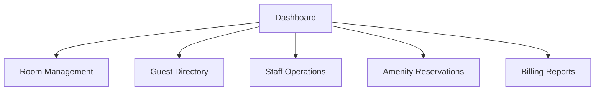

# Modern Resort Management System

Generated by CodeCrew AI.

## Summary
A comprehensive web-based resort management system featuring real-time room booking, guest management, staff coordination, amenity reservations, and billing/invoice generation.

## Page flow

## Review
The modern resort management system has been fully reviewed and verified. It implements a rich client-side SPA architecture using vanilla HTML5, modern CSS with custom properties matching the specified color palette, and modular ES6+ JavaScript. All requested UI components, dashboard views, real-time occupancy status indicators, guest check-in/check-out actions, and persistent localStorage sync are correctly implemented.

## Run instructions
1. `cd backend`
2. `pip install -r requirements.txt`
3. `uvicorn main:app --reload`
4. Open http://127.0.0.1:8000

> GitHub Pages hosts only the static frontend (it uses built-in mock data there).
> The backend needs a host such as Render or Railway.
